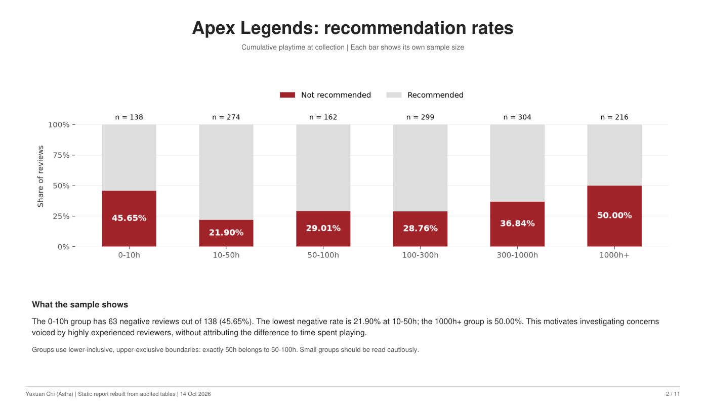
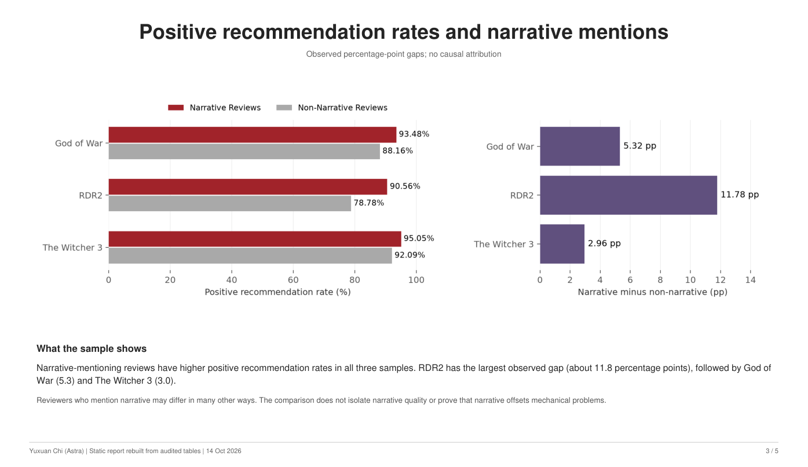

# Game Portfolio - Yuxuan Chi (Astra)

Player research, commercial interpretation and branching narrative prototypes.

## Start here

| Project | Open the finished work | My contribution |
| --- | --- | --- |
| Steam review diagnostics | [Read the report](dashboards/Steam%20Review%20Diagnostics%20by%20Playtime%20Stage.pdf) | Compared recommendation rates and theme mentions across playtime groups; documented product questions and source revisions. |
| Narrative and recommendation rates | [Read the report](dashboards/Narrative%20as%20a%20Satisfaction%20Buffer.pdf) | Analysed 15,000 reviews, compared narrative mention groups and developed hypotheses to test. |
| The Mine and The Moon | **[Play The Mine](https://astraaaqaq.itch.io/the-mine)** / **[Play The Moon](https://astraaaqaq.itch.io/the-moon)** | Adapted original fiction into two Twine prototypes with branching choices, hidden variables and documented consequences. |

| Case 1 - recommendation rates | Case 2 - narrative association |
| --- | --- |
| [](dashboards/Steam%20Review%20Diagnostics%20by%20Playtime%20Stage.pdf) | [](dashboards/Narrative%20as%20a%20Satisfaction%20Buffer.pdf) |

[Project goals, scope and delivery decisions](docs/project-delivery.md) · [Methods and data corrections](docs/data-audit.md) · [Notion portfolio](https://app.notion.com/p/3536abdd1976809298f4e24d30c3a2fa)

## 1. Steam Review Diagnostics by Playtime Stage

**Question:** How do recommendation rates and theme mentions differ between reviewers with different amounts of cumulative playtime?

The frozen cohorts contain 1,393 Apex Legends, 1,445 Icarus and 1,496 Path of Exile reviews. The analysis compares recommendation rates, themes in negative reviews and theme mentions in 50h+ positive versus negative reviews. These are reviewer-group comparisons, not measurements of retention or churn.

- [Full report](dashboards/Steam%20Review%20Diagnostics%20by%20Playtime%20Stage.pdf)
- [Counts and rates](data/lifecycle_risk_map_pct.csv)
- [Method, dictionaries and limitations](docs/case1-method.md)
- [Rebuild script](scripts/rebuild_case1_assets.py) and [source manifest](data/case1_provenance.json)

## 2. Narrative as a Satisfaction Buffer

**Question:** Are narrative mentions associated with higher positive recommendation rates, and how does the association differ by game and playtime group?

The study uses 5,000 eligible English reviews each for God of War, RDR2 and The Witcher 3. Narrative mentions were associated with higher positive recommendation rates. "Satisfaction buffer" describes the hypothesis being explored; the data does not establish retention, re-engagement or a causal narrative effect.

- [Full report](dashboards/Narrative%20as%20a%20Satisfaction%20Buffer.pdf)
- [Narrative versus non-narrative rates](data/narrative_vs_nonnarrative.csv)
- [Playtime comparisons with subgroup counts](data/narrative_lift_by_playtime_stable.csv)
- [Co-occurrence comparison](data/compensation_flaw_wide.csv)
- [Rebuild script](scripts/rebuild_case2_narrative_assets.py) and [source manifest](data/case2_provenance.json)

## 3. The Mine and The Moon

The Mine connects earlier choices to a final appeal through Leverage, Spark and Solidarity. The Moon explores possession, release and rebellion through Mara's choices.

- **[Play The Mine](https://astraaaqaq.itch.io/the-mine)** / **[Play The Moon](https://astraaaqaq.itch.io/the-moon)**
- [Main-route flowchart](narrative/main-route-flowchart.png) / [Side-route flowchart](narrative/side-route-flowchart.png)
- [Design text](narrative/demo-text.md) / [Artifact notes](narrative/README.md)

## Reproduce and inspect

Install dependencies with `pip install -r requirements.txt`. Public aggregates can be checked without private review text:

```bash
python scripts/validate_portfolio.py
python -m unittest discover -s tests
```

Frozen review files are private and excluded from Git. With those files available locally:

```bash
python scripts/rebuild_case1_assets.py --input-dir private_data/case1
python scripts/rebuild_case2_narrative_assets.py --reuse-private --input-dir private_data
python scripts/render_reports.py
```

The [six notebooks](notebooks/README.md) preserve historical exploration and have method notes and no saved outputs. Their live collection cells do not reproduce the frozen snapshot.

Current PDFs are static walkthroughs rebuilt from reconciled CSVs. Original Power BI files remain historical sources and require a separate native refresh to match this revision. See [report and Power BI notes](dashboards/README.md).
